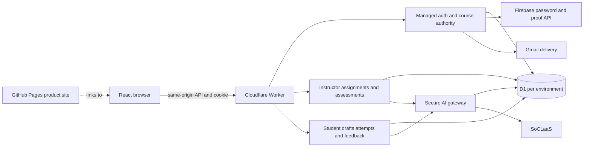
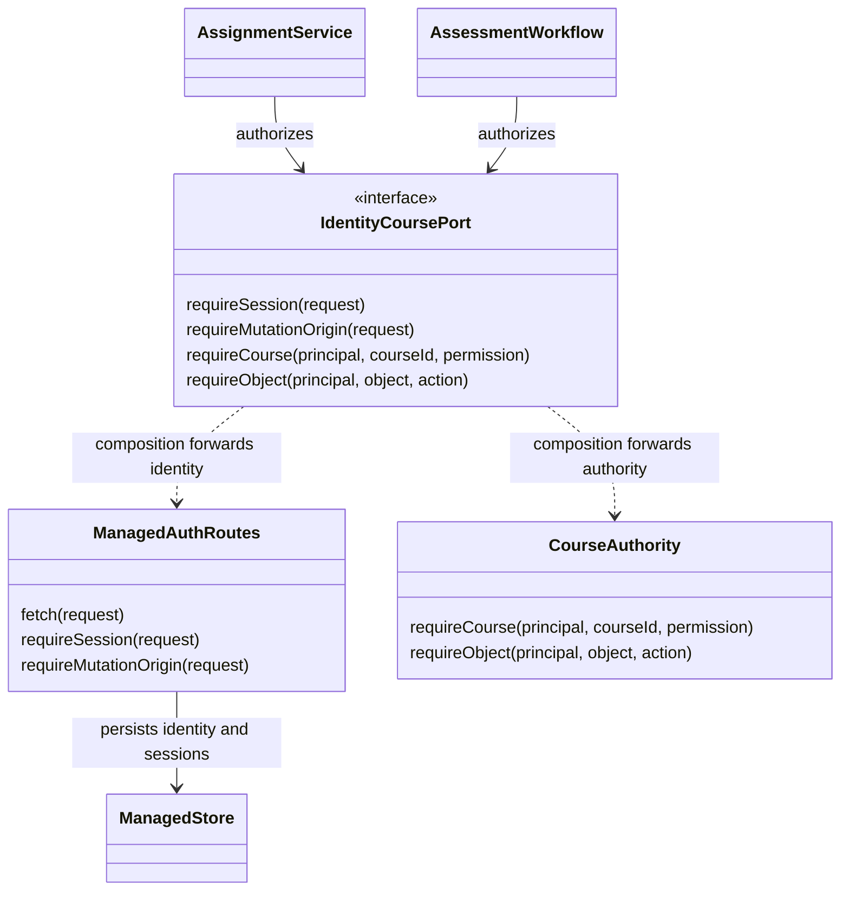
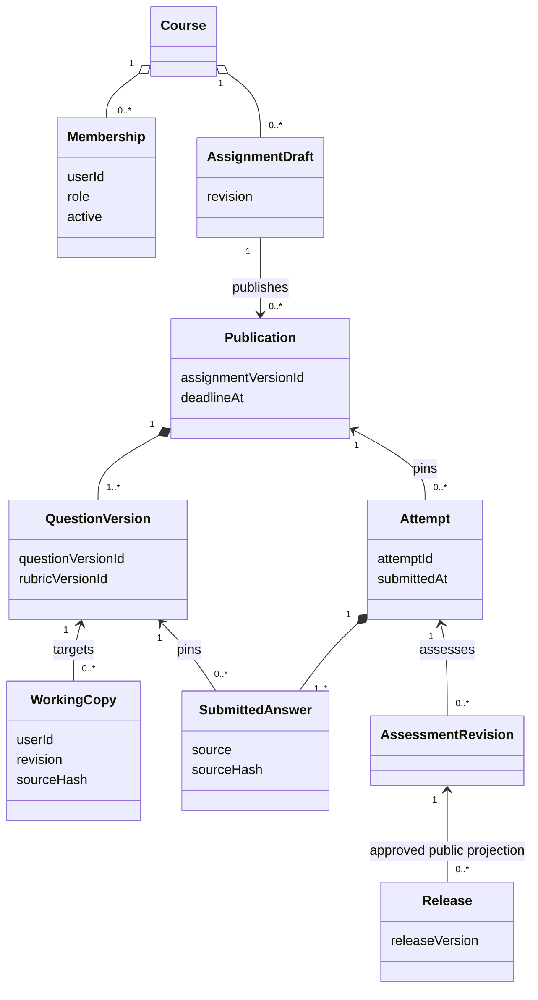
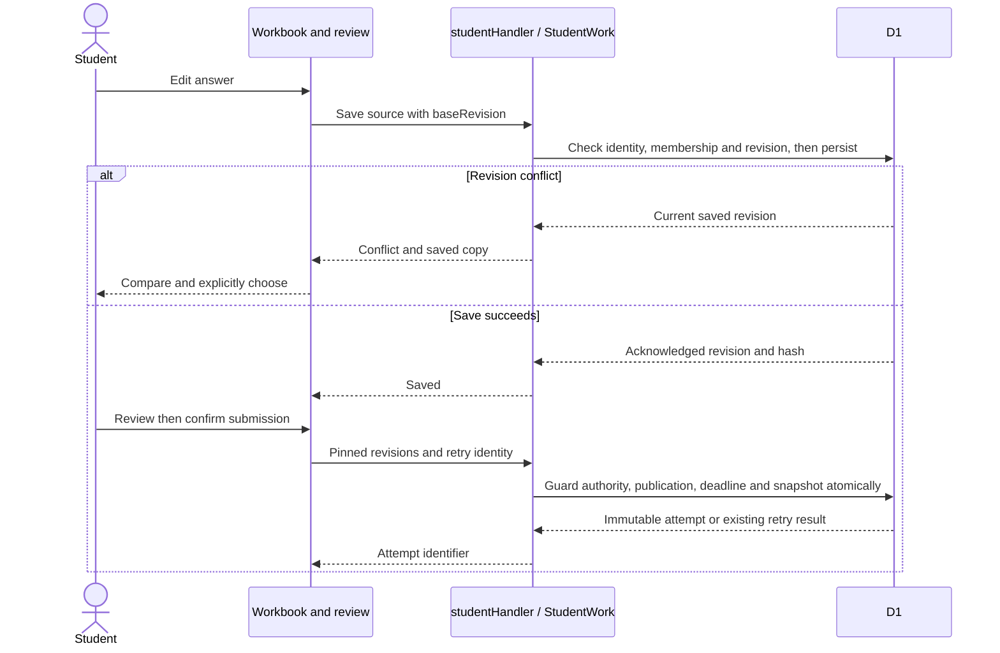
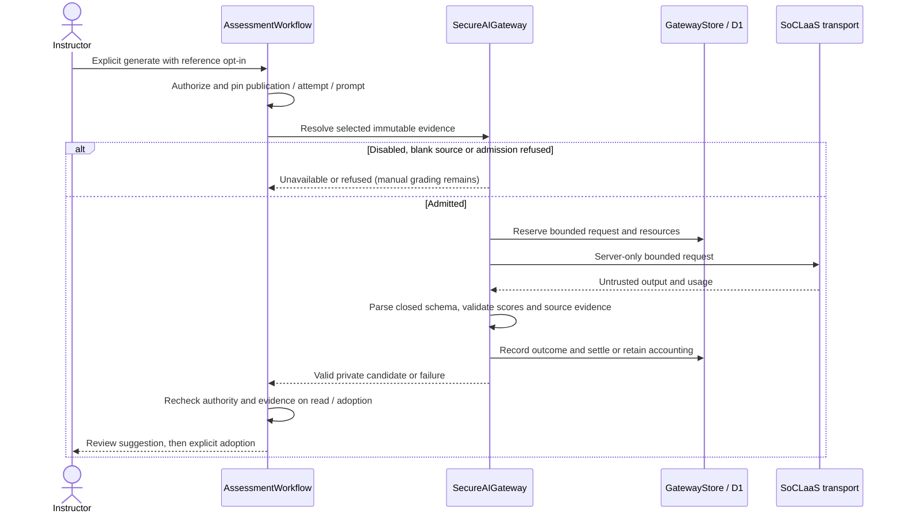
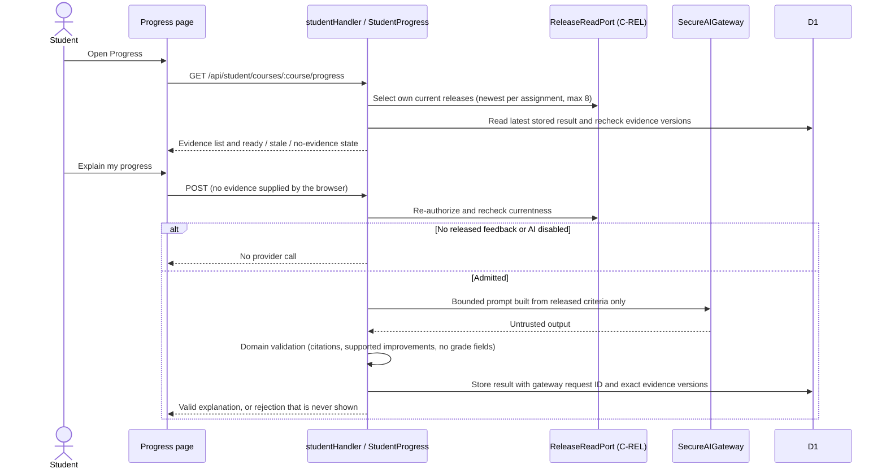

# Codewise Developer Guide

Baseline: `4ed8d0d`, updated 13 November 2026 (Singapore time). This guide describes current source, not certification that the same revision is deployed. See [submission verification](../workflow/evidence/final-submission/verification.md) for checks and release gaps, and [User Guide](UserGuide.md) for interactions.

## Architecture and ownership

One React/Vite browser application calls one native Cloudflare Worker API backed by a D1 database per environment. Firebase supplies password/proof authority; the Worker maps identity into one authoritative application account/session/course store. Gmail delivers configured proof links. Student and instructor modules share that store. SoCLaaS is called only through the server gateway, which has two consumers: instructor assessment drafts and student progress explanations.

This component overview uses architectural notation. The following class, sequence and state diagrams are UML views; GitHub renders their Mermaid blocks. Diagrams omit unrelated detail; source and runtime validators are authoritative.



| Location                                        | Responsibility                                                                                                     |
| ----------------------------------------------- | ------------------------------------------------------------------------------------------------------------------ |
| `src/web/main.tsx`                              | Public entry and browser route selection                                                                           |
| `src/web/auth/`, `src/web/ui/`                  | Auth screens, shared workbook controls, icons, course navigation, context switch and sanitized instructions        |
| `src/web/instructor/`, `src/server/instructor/` | Darryl: authoring/publication, grading (attempt review, assessment/approval/release)                               |
| `src/web/student/`, `src/server/student/`       | Keith: discovery, editor/drafts, immutable attempts, per-question attempt/feedback views and progress explanations |
| `src/server/index.ts`                           | API composition, health, API reservation, assets and security headers                                              |
| `src/server/auth/`, `src/server/courses/`       | Darryl: shared accounts/sessions, invitations/recovery, membership/object authorization                            |
| `src/server/ai/`                                | Server-only transport, admission/accounting, context resolution and validation                                     |
| `src/shared/`                                   | DTOs and closed runtime schemas; parsing is not authorization                                                      |
| `src/server/db/migrations/`                     | Ordered shared SQL migrations; one active schema writer                                                            |
| `src/product-site/`                             | GitHub Pages website source; guides are rendered in at build time                                                  |
| `docs/images/`                                  | Guide figures (synthetic screenshots); copied into the product site at build time                                  |

Read [Ownership](../workflow/Ownership.md) and [IntegrationContracts](../workflow/IntegrationContracts.md) before shared-service edits. Both members review composed boundaries; policy agreement does not replace exact-revision consumer acceptance. These diagrams describe source composition, not completion of all historical OpenSpec gates.

## Identity and object authorization

The active composition in `src/server/index.ts` uses `ManagedAuthRoutes`, `ManagedStore`, `CourseAuthority` and `composeIdentityCourse`. Retained Google/OIDC adapter code and early workflow notes describe an earlier integration, not the active Firebase browser path.



Session cookies identify server-validated accounts. Mutations require exact-origin/CSRF checks. Resolve an object's authoritative course before private reads/writes; browser role/course values never authorize. Guarded D1 writes recheck authority against revocation between initial lookup and commit. Workspace switching uses trusted contexts for presentation only. Student DTOs exclude references, private assessments and provider payloads. Protected responses are no-store. Secrets never belong in `VITE_*`, fixtures or logs.

## Versioned work and submissions

An instructor draft is revision-checked and editable. Publication freezes question order/content, rubric and version IDs. Student working copies belong to an account and published question version. Submission freezes acknowledged answer revisions into an immutable attempt. Assessment pins publication, attempt and source hashes, so later working-copy edits cannot change evidence.

This conceptual UML model summarizes relationships, not literal SQL tables. Migrations and `src/shared/instructor-contracts/` define fields and keys.





`src/server/student/http.ts`, `work.ts` and tests define body bounds, conflicts, atomic snapshots, deadline equality, retry fingerprints and limits. Source normalizes to LF with a 32 KiB per-question limit. Inspect these before changing policy. Tab recovery does not establish a server save. No submitted Python is executed.

The workbook (`src/web/student/Workbook.tsx`) renders three per-question answer views: **Working copy**, **Submitted attempt** and **Released feedback** (`student-question-views`, SQ-01–SQ-07). The historical views keep `?view=submitted|feedback&attempt=ID` in the URL, which `src/web/student/model.ts` parses. They follow the selected attempt's own pinned publication and question order, never the working copy or a newer version, and end in the all-question **Attempt summary** (`Attempts.tsx`). They reuse the existing `GET /api/student/publications/:pub/attempts`, `/attempts/:id` and `/attempts/:id/feedback[/:version]` reads, so every load re-authorizes the attempt server-side. A forged or foreign ID gets the same unavailable state as a missing one.

## Assessment and release

`AssessmentWorkflow` composes identity, `AssignmentService`, `AssessmentRepository` and real `D1SubmissionCatalog`. `D1OwnedAttemptReader` and student release ports bind reads to the current account and exact attempt. Normal composition uses real D1 submissions; sample injection is restricted to explicit loopback development.

This state diagram expresses approval/publication semantics. Corrections create new revisions/releases with retained history; withdrawal exposes a public tombstone rather than deleting the attempt or audit.

```mermaid
stateDiagram-v2
  [*] --> Draft
  Draft --> Draft: Edit and save revision
  Draft --> Approved: Complete valid grading and approve
  Approved --> Draft: Edit invalidates approval
  Approved --> Released: Explicit release of approved revision
  Released --> CorrectionDraft: Create correction revision
  CorrectionDraft --> CorrectionApproved: Save valid grading and approve
  CorrectionApproved --> CorrectionDraft: Edit invalidates approval
  CorrectionApproved --> Released: Release new version; prior version replaced
  Released --> Withdrawn: Withdraw selected public version
```



Source observations require valid ranges and exact excerpts against immutable submitted source. Student feedback distinguishes current/replaced/withdrawn versions. Unmatched observations are not attached to unrelated lines. Suggestion adoption, approval and release are separate server operations; disabling UI controls is insufficient enforcement.

## Server-only AI and resources



The gateway implements configuration, admission, reuse, retry and uncertain-work accounting. Cached results still require current authorization. Do not clear debt after a timeout or infer provider capability from an application output cap. Verify model access/quotas before activation. The evaluation-specific no-retry adapter does not mean all runtime requests never retry.

The [12-attempt live evaluation](../workflow/evidence/instructor-ai-assessment/live-quality-evaluation.md) concludes **needs repair**: schema-valid candidates had wrong scores or contradictory explanations. Blank-source guards and prompt repairs narrow failures without proving reliability or general injection resistance. Prompt fingerprint changes can invalidate old candidates with `STALE_EVIDENCE`; 512-output profiles now fail closed. Review compatibility, supported output/framing limits and cross-environment budget coordination before activation. This documentation update makes no provider calls.

## Student progress explanations

`src/server/student/progress.ts` (Keith, `student-progress` SP-01–SP-10, refining PROG-01–03) is the gateway's second consumer. It uses the `progress-explanation` action. Shared DTOs and the output schema live in `src/shared/student-progress.ts`; the page is `src/web/student/Progress.tsx` at `/student/courses/:course/progress`.



The browser never supplies evidence. The server selects it from the caller's own attempts in the course: the newest attempt with a current release for each assignment, newest first, at most 8, from a 50-attempt window. Unreleased, withdrawn and superseded feedback, classmates' data and private references are never selected. Every explanation summarises the newest 3 releases. A criterion name is comparable only when at least two selected releases share it, and only comparable names may appear in recurring issues or improvements. Full-marks encouragement is computed from scores, not by the model.

Prompt-injection defences (design D9): the server computes the facts and the model only words them, opaque `R…`/`K…` labels replace real IDs, facts and notes are kept separate, and text checks reject URLs, code, scores and override phrases. The validator rejects any citation outside the selection, any improvement not backed by released scores, and any grade field. The latest result is stored in `student_progress_results` (migration `0017_student_progress.sql`). Every read re-selects evidence; if anything changed, the result is reported **stale** and its text is withheld. Requests are rate-limited through the student `progress` action.

Configuration: `SOCLAAS_STUDENT_ENABLED=true` plus a valid `SOCLAAS_STUDENT_CONFIG` (same keys as the instructor config, parsed by `studentAIConfig` in `src/server/ai/runtime-config.ts`) and `SOCLAAS_STUDENT_API_KEY`. Without them the page reports that explanations are unavailable. `GatewayStore` pins one `soclaas-shared` quota policy, so while both consumers are enabled the student config's six limit values must equal the instructor's, or student admissions fail closed. The shared wiring in `environment.ts`, `runtime-config.ts` and `index.ts` still awaits Darryl's review (see the [handoff](../workflow/handoffs/student-progress.md)). Only a small number of live samples exist for the revised prompt; see [verification](../workflow/evidence/student-progress/verification.md).

## Browser and API entry points

| Browser entry                                                                 | Function                                                               |
| ----------------------------------------------------------------------------- | ---------------------------------------------------------------------- |
| `/`                                                                           | Public introduction                                                    |
| `/sign-in`, `/auth/finish`, `/auth/forgot`, `/auth/reset`, `/auth/action`     | Authentication/proof/recovery                                          |
| `/auth/invitations?courseId=…`                                                | Authorized People/invitation UI                                        |
| `/workspace`                                                                  | Resolve available context; optional role hint grants no permissions    |
| `/instructor/assignments` and `/instructor/assignments/:id`                   | Authoring                                                              |
| `/instructor/review`, `/instructor/review/:id`, `/instructor/assessments/:id` | Grading: assignment and version selection, then assessment             |
| `/student`, `/student/courses/:course/assignments`                            | Student course list and assignment list                                |
| `/student/assignments/:pub`                                                   | Read-only published overview and latest-attempt entry                  |
| `/student/assignments/:pub/work/:n[?view=submitted\|feedback&attempt=ID]`     | Workbook question `n` in one of the three answer views                 |
| `/student/courses/:course/progress`                                           | Progress page; student routes are parsed by `src/web/student/model.ts` |

API groups: `/api/auth/*`, `/api/courses/*`, `/api/instructor/*`, `/api/student/*` (including `GET`/`POST /api/student/courses/:course/progress`), and public `GET /api/health`. Their route handlers and shared schemas define exact verbs/payloads. Unknown API paths return JSON errors rather than SPA HTML. Health tests metadata readiness, not all tables, providers or feature flows.

## Local setup

Use Node.js 22.12+ and the lockfile (CI uses Node 22). In PowerShell use `.cmd` wrappers when script execution policy requires them.

```powershell
npm.cmd ci
npm.cmd run build
npm.cmd run db:local
npm.cmd run dev:api
```

Open <http://127.0.0.1:8787>. Before authenticated use, copy `.dev.vars.example` into ignored `.dev.vars`, configure Firebase, exact `AUTH_ORIGIN=http://127.0.0.1:8787`, owner bootstrap and mail as described by the current example and [auth runbook](../workflow/auth/README.md). The current setup section supersedes its preserved historical Google notes; active `firebase.ts`, `managed-routes.ts`, and `environment.ts` define runtime configuration. Never put credentials in guides, chat or source. Keep both `SOCLAAS_INSTRUCTOR_ENABLED` and `SOCLAAS_STUDENT_ENABLED` set to `false` for manual testing unless provider access and quotas have been verified.

`npm.cmd run dev` starts Wrangler/Vite at 8787/5173 for UI iteration; prefer the configured single origin for real auth/CSRF testing. `npm.cmd run dev:workflow -- --setup-owner-course` sets up a synthetic local instructor course for an existing configured owner, not remote provisioning. Isolated `dev:instructor`, `dev:assessment` and `dev:auth` previews use synthetic adapters; label evidence accordingly. Inspect local student seed plans in `workflow/student/` before use.

## Verification and code quality

```powershell
npm.cmd run check
npm.cmd run format:check
```

`check` runs strict OpenSpec validation, TypeScript, ESLint, Vitest, deployment-gate tests and client build. Formatting is separate. On `4ed8d0d`, `npm run check` passed during this update (70 test files passed and 3 skipped; 895 tests passed and 4 skipped). See [earlier audit results](../workflow/evidence/final-submission/verification.md): a focused rerun does not make an earlier failed command pass. Use integration/security checks for changed boundaries. CI also scans secrets, audits dependencies and bundles the Worker. Opt-in live evaluation must not run during ordinary tests.

UI follows [warm-workbook-v1](ui/design.md) with dated approved refinements, UI-01–UI-08, shared controls/palette, accessible navigation and explicit version/save/error states. Complete the [UI review](../workflow/templates/ui-review.md) for app UI changes. This pass changes the guides, their figures and the product-site build rather than application UI or permissions.

User Guide figures live in `docs/images/user-guide/`. They were captured from the real application with a throwaway harness that was not committed. It ran the composed Worker locally on a separate D1 state directory with fictitious accounts, stubbed the Firebase admin calls, and inserted the seed accounts, sessions and one pending invitation directly into that throwaway database. The app's own APIs and UI produced the assignment, attempts, grading and release. The AI suggestion figure uses `syntheticAssessmentGateway` from `workflow/connected-preview/`. Recapture with synthetic data only and never point such a harness at a shared database.

## Agentic SE process and workflow files

Read `AGENTS.md`, `openspec/config.yaml`, relevant proposal/design/spec/tasks, ownership and contracts before bounded changes. The coordinator assigns requirements and write ownership; specification clarifies scenarios; implementation supplies code/evidence; independent review returns findings to the writer; humans accept and release. Role files alone are not proof separate agents ran. This guide update used one main agent and no children. DEV-01–DEV-04 cover change control, coordination, security and evidenced deliverables.

The [per-file inventory](../workflow/FILE-INDEX.md) provides a brief purpose for every workflow file. Directory map:

| Location                                                                                      | Purpose                                                                                         |
| --------------------------------------------------------------------------------------------- | ----------------------------------------------------------------------------------------------- |
| `workflow/agents/`                                                                            | Coordinator/specification/implementation/reviewer instructions                                  |
| `workflow/templates/`, `workflow/handoffs/`                                                   | Log/review templates and dated transitions with revisions, findings, blockers and next owner    |
| `workflow/Ownership.md`, `workflow/IntegrationContracts.md`                                   | Writers, interfaces, decisions and historical agreements                                        |
| `workflow/contracts/`, `workflow/fixtures/`                                                   | Reusable acceptance checks and synthetic fixtures                                               |
| `workflow/scripts/`                                                                           | Deploy configuration, trusted-release gate, smoke checks and tests                              |
| `workflow/auth/`, `workflow/course/`, `workflow/student/`                                     | Local provisioning plans/operators and boundary checks                                          |
| `workflow/instructor-preview/`, `workflow/assessment-preview/`, `workflow/connected-preview/` | Isolated/connected previews, adapters and integration checks                                    |
| `workflow/measured-evaluation/`                                                               | Deterministic context/validator controls and assistant review                                   |
| `workflow/ai-quality-evaluation/`                                                             | Opt-in bounded live evaluation, accounting/no-retry controls and offline rehearsals             |
| `workflow/experiment-tracker/`                                                                | Explicit recording controls, redacted exports and coverage tests; private runtime stays ignored |
| `workflow/evidence/`                                                                          | Change-grouped verification, synthetic browser captures, metrics, manifests and findings        |
| `workflow/README.md`, `workflow/FILE-INDEX.md`                                                | Entry point and file catalogue                                                                  |

Conventional exceptions are deliberate: `.github/` hosts tool-discovered Actions/PR configuration; `openspec/` hosts CLI-discovered specs; `.agents/skills/` hosts assistant skills; root build/lint/config/lock files are tool entry points; `src/` is product code; `docs/` and `logs/` are required deliverables. Moving these into `workflow/` would break discovery or obscure product code. Graders, fixtures and preview adapters naturally remain under `workflow/`. Historical evidence is preserved.

Darryl logs every prompt with its own Agents spawned and Token count sections. Keith uses substantial-request checkpoints and explicit recorder opt-in. See [policy](../logs/README.md) and [summary index](../logs/INDEX.md). Do not infer missing agents, tokens or reviews. Reconcile provisional measurements when scoped telemetry is available; report missing measurements honestly. [Reflections](Reflections.md) separates observations from confounded comparisons.

## Releases and GitHub Pages

`.github/workflows/deploy-staging.yml` runs master-push CI and staging deployment/smoke, then protected production approval with the same run's artifact/trust checks. Follow [Deployment](Deployment.md); no ad hoc production migrations or development-data publication. Record commit, Actions run, smoke and authenticated acceptance before claiming feature-release readiness. Historical foundation deployment is not the current release manifest. The production job's "Verify exact staging artifact and current master revision" step (`workflow/scripts/release-gate.mjs`) refuses to promote a run when `master` has moved since its staging deployment and fails with "Main has changed since staging". This is expected: promote the newer run for the current `master` instead.

`.github/workflows/product-site.yml` runs `npm run site:build` (`workflow/scripts/build-product-site.mjs`), which copies `src/product-site/` and `docs/images/` and renders this guide and the [User Guide](UserGuide.md) into `site-dist/user-guide.html` and `site-dist/developer-guide.html` (relative guide images resolve to the copied `images/`, GitHub-style heading anchors, browser-rendered Mermaid, guide-to-guide links kept on the site, other repository links sent to GitHub). It uploads `site-dist/` and deploys it through `github-pages` on main. Settings → Pages must use **GitHub Actions**. The site's primary app link is the production sign-in. Site changes become public after the reviewed workflow succeeds; this audit prepares files without claiming a fresh remote publication.

## Acknowledgements

Known reuse visible in repository records is listed below. Members must verify attribution and add omitted external snippets/assets before submission. Dependencies retain their upstream licenses; exact versions/transitive packages are in `package.json` and the lockfile.

| Source                                                                                                                                                                                                                                                                  | Use                                                                                                         |
| ----------------------------------------------------------------------------------------------------------------------------------------------------------------------------------------------------------------------------------------------------------------------- | ----------------------------------------------------------------------------------------------------------- |
| [OpenSpec](https://github.com/Fission-AI/OpenSpec)                                                                                                                                                                                                                      | Spec schema, CLI and generated assistant integrations                                                       |
| [React](https://react.dev/), [Vite](https://vite.dev/), [TypeScript](https://www.typescriptlang.org/)                                                                                                                                                                   | Browser implementation and build/type tools                                                                 |
| [Cloudflare Workers](https://developers.cloudflare.com/workers/), [D1](https://developers.cloudflare.com/d1/)                                                                                                                                                           | Worker/storage/migration/deploy patterns and Wrangler                                                       |
| [Firebase Authentication](https://firebase.google.com/docs/auth), [Gmail](https://developers.google.com/gmail)                                                                                                                                                          | Password/proof authority and configured email transport                                                     |
| [openid-client](https://github.com/panva/openid-client)                                                                                                                                                                                                                 | Retained earlier OIDC adapter                                                                               |
| [Prism](https://prismjs.com/), [react-markdown](https://github.com/remarkjs/react-markdown), [remark-gfm](https://github.com/remarkjs/remark-gfm), [rehype-raw](https://github.com/rehypejs/rehype-raw), [rehype-sanitize](https://github.com/rehypejs/rehype-sanitize) | Highlighting and formatted/sanitized instructions                                                           |
| [Vitest](https://vitest.dev/), [Testing Library](https://testing-library.com/), [jsdom](https://github.com/jsdom/jsdom), [ESLint](https://eslint.org/), [Prettier](https://prettier.io/)                                                                                | Tests and code quality                                                                                      |
| [GitHub Pages](https://docs.github.com/en/pages), [Mermaid](https://mermaid.js.org/)                                                                                                                                                                                    | Product-site publishing and diagram notation                                                                |
| [NUS SoCLaaS](https://dochub.comp.nus.edu.sg/cf/guides/soclaas/)                                                                                                                                                                                                        | Required server-side model service                                                                          |
| Team-supplied SourceAcademy screenshot                                                                                                                                                                                                                                  | Recorded layout inspiration; no SourceAcademy code copying claimed                                          |
| Team MP3 contribution conventions                                                                                                                                                                                                                                       | Log organization inspiration; no MP3 app code copying claimed                                               |
| AI development assistants                                                                                                                                                                                                                                               | Planning, implementation, reviews and documentation, summarized in `logs/` and subject to team verification |

The UML views were prepared from repository source. The User Guide figures are original screenshots of Codewise with synthetic data; no external screenshots or third-party image assets were added.
