# Codewise User Guide

Baseline: repository `4ed8d0d`, updated 13 November 2026 (Singapore time). This guide describes the implemented browser application. Hosted availability depends on the revision and configuration deployed by the team. Local implementation and synthetic screenshots are not proof of a hosted release.

## Access and testing

Codewise is a programming workbook. Instructors publish Python assignments and review submitted work. Students write answers, submit immutable attempts, read feedback after the instructor releases it, and can ask for a private AI explanation of their progress. Codewise does not execute submitted code or automatically run tests.

| Destination     | Address                                                                | Purpose                                               |
| --------------- | ---------------------------------------------------------------------- | ----------------------------------------------------- |
| Product website | <https://cs3227-2610-mp4-codewise.github.io/CS3227-2610-MP4/>          | Project information and guides; separate from the app |
| Staging app     | <https://codewise-staging.codewise-cs3227-2610.workers.dev/sign-in>    | Team-managed testing                                  |
| Production app  | <https://codewise-production.codewise-cs3227-2610.workers.dev/sign-in> | Team-managed release                                  |
| Local app       | <http://127.0.0.1:8787/sign-in>                                        | Requires developer setup                              |

**Reviewer test account:** reviewers can sign in on the [production app](https://codewise-production.codewise-cs3227-2610.workers.dev/sign-in) with this shared Instructor account:

| Field    | Value                  |
| -------- | ---------------------- |
| Email    | `instructor@u.nus.edu` |
| Password | `12345678`             |

Use it to create a course and to add Instructor or Student users from **People** (see [Instructor: courses and People](#instructor-courses-and-people)). Invitations are emailed, so invite NUS addresses you can receive mail at, then accept them to create those accounts. Do not change this account's password. There is no public registration, and you cannot grant yourself Instructor access from another account. Use synthetic data only. See the [submission release checklist](../workflow/evidence/final-submission/verification.md); older foundation evidence does not verify current feature flows.

For local testing, a developer must configure Firebase/password and email integration in the ignored local environment file. See [developer setup](DeveloperGuide.md#local-setup). Installation without credentials can run automated tests and display the public page, but cannot provide a complete sign-in test. Use the configured single origin `127.0.0.1:8787` for authenticated testing.

**About the screenshots:** every figure was captured from the real application at `4ed8d0d`, running locally with fictitious accounts (`*.demo@u.nus.edu`), synthetic courses and synthetic Python answers. The AI suggestion in Figure UG-11 comes from the repository's synthetic preview adapter, not from a live model. No passwords, invitation links or provider secrets appear. If you capture your own screenshots, follow the same rules.

## Sign in and join a course

1. Open the invitation supplied by your instructor. It identifies the intended course and role.
2. Use the invited NUS email (supported domains: `u.nus.edu`, `u.duke.nus.edu`, `u.yale-nus.edu.sg`). Passwords must contain 8–64 characters. Follow the setup form. New recipients choose and confirm a password. Existing recipients use their existing account password; validated acceptance adds the invited course role to the same account.
3. Complete any email proof/recovery step shown. For an invalid or expired link, request a replacement rather than editing it.
4. On later visits, enter your **NUS email** and **Codewise password** and choose **Sign in**. If you have forgotten the password, use **Forgot password?**, then follow the email and reset form.
5. **Courses** lists the courses available in your current workspace. Students choose **View assignments**; instructors choose **Open course**. An account with both roles sees a **Student / Instructor** switch in the header. Switching changes which of your courses are shown; it never grants a membership you do not have.
6. Sign out from the **Account** menu. If your session expires or access changes, sign in again or return to an available workspace as directed.

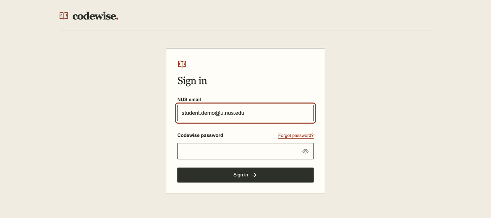

_Figure UG-01 — Sign in. The password field is left empty._

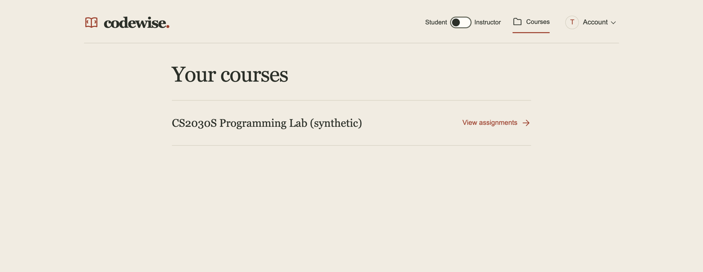

_Figure UG-02 — Course entry for a dual-role account. The Student/Instructor switch appears only when you hold both roles._

## Instructor: courses and People

Eligible instructors and the configured starting owner can create a course with **Create course** in the instructor course list. Enter its details and submit the form. An account without server-side authority cannot complete this action.

An open course has three sections: **Assignments**, **Grading** and **People**. Select **People** to see members and pending invitations. To invite someone, enter their **NUS email**, choose **Student** or **Instructor** under **Role**, and choose **Send invitation**. The role takes effect after validated acceptance; existing accounts keep their other course roles. A pending invitation shows **Awaiting acceptance** and its email status. Use **Resend** for an available pending invitation and **Revoke** to invalidate it, confirming when prompted. **Remove from course** removes that membership after confirmation; it does not delete the account or its other course memberships. Password recovery does not change course membership. **About invitation status** explains each status.

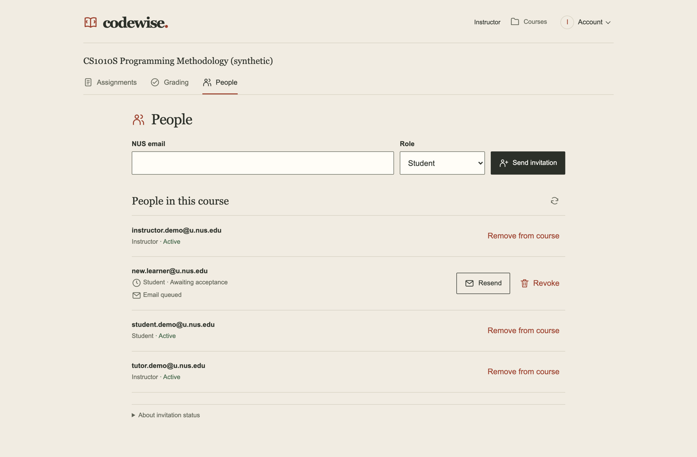

_Figure UG-03 — People: role-targeted invitation form, members, and a pending invitation awaiting acceptance._

## Instructor: create and publish assignments

1. Open the course's **Assignments** section and choose **New assignment**. A draft opens.
2. Under **Assignment details**, enter the **Title** and **Due date (Singapore time)**. The server stores the deadline in UTC.
3. Choose **Add question** for each question. Enter the **Question title** and **Instructions for students**. Instructions support formatted content: use the toolbar, then **Preview** to check headings, lists and code before publishing. Add optional **Starter code (Python)**. The **Reference solution** section is marked **Instructor only** and stays private; it is separate from student-visible starter code.
4. Under **Marking rubric**, choose **Add criterion** and fill in **Name**, **Scoring guidance** and **Maximum points**. Every question needs at least one criterion before publishing.
5. Use the question list, **Previous question** / **Next question** and **Reorder questions** to check order. Use **Remove question** or **Remove criterion** to delete items.
6. Choose **Save draft** and wait for **All changes saved**. Saving does not publish. Resolve any validation or revision-conflict message first.
7. Choose **Review & publish**. The **Ready to publish?** review lists the title, deadline and questions. Choose **Publish assignment** to publish, or **Continue editing** to go back. Publishing creates a fixed, immutable version. Later edits stay in your draft until you publish again, which creates a newer version; existing student attempts keep their original version.
8. Open **Version history** to confirm what was released. Published versions are read only.

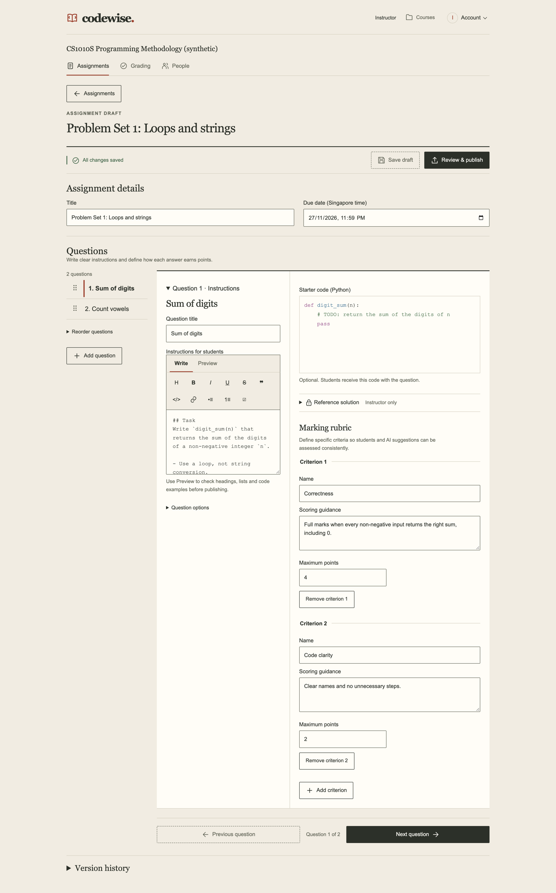

_Figure UG-04 — Authoring a question with instructions, starter code and rubric. The private reference solution stays collapsed._

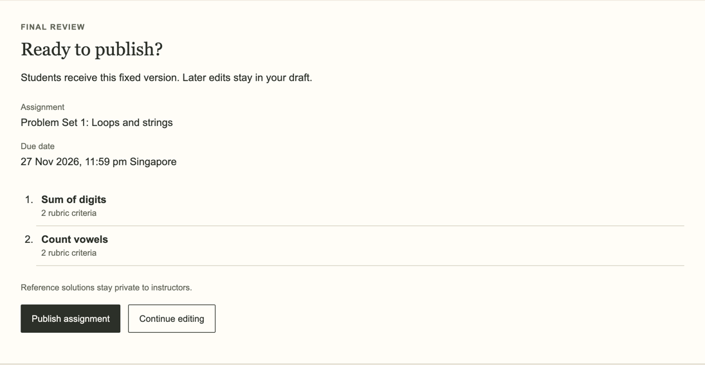

_Figure UG-05a — Publication review._

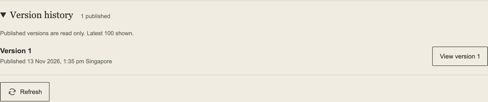

_Figure UG-05b — The published version in Version history._

## Student: find work and edit answers

From **Courses**, choose **View assignments** for a course. The assignment list shows each published assignment with its deadline in Singapore time. Rows may show **Due soon**, **Submitted** or **Feedback released** based on server-reported state; these labels do not replace the exact attempt or deadline details. Unpublished instructor drafts are never shown to students. **View my progress** opens the course's [Progress](#student-understand-your-progress) page.

Open an assignment to see a read-only overview of the published version: the deadline, publication time, every question, its starter code and rubric guidance. Choose **Open my work** to start or continue. After your first submission, the overview also offers **View latest submission**, or **View released feedback** when that attempt has released feedback.

The workbook shows one question at a time, with the question text and rubric guidance on the left and your answer on the right. The answer pane has three tabs:

- **Working copy**: your editable Python answer.
- **Submitted attempt**: a read-only answer from one of your attempts.
- **Released feedback**: the instructor's released feedback for one of your attempts.

Use **Previous question** and **Next question** to move between questions. On the last question of your working copy, the forward button becomes **Review assignment**. Starter code is a starting point, not a submission. Tab indents four spaces; press Esc then Tab to leave the editor using the keyboard.

Answers save automatically. Wait for the server-acknowledged state, for example **Saved. Revision 1.** An unsaved, saving or failed state is not confirmation. The source limit is 32 KiB per question after newline normalization. There is no code execution or Run output.

When another tab or device saves a different version of the same answer, the workbook shows a **Save conflict**. It compares **My version (this tab)** with the **Saved version** line by line, and nothing is replaced until you choose. **Keep my version** and **Use saved version** each ask you to confirm first: for example, keeping yours offers **Copy other version**, **Keep mine and discard saved** and **Back**. Copy any version you want to preserve before confirming. If the clipboard fails, a manual-copy fallback is shown. A same-tab recovery copy does not mean the server saved your work.

When a newer publication of the assignment appears, your answer is not silently overwritten. Use **Move my work to the newer version…** and review the replacement choices. Existing work on the newer version must be explicitly selected before it is replaced; changed questions may need manual editing.

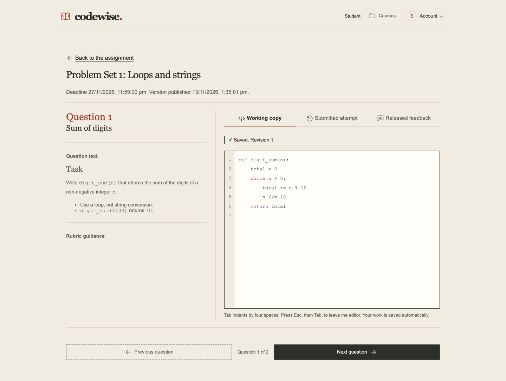

_Figure UG-06 — Workbook: question, Python working copy, saved status, the three answer tabs and question navigation._

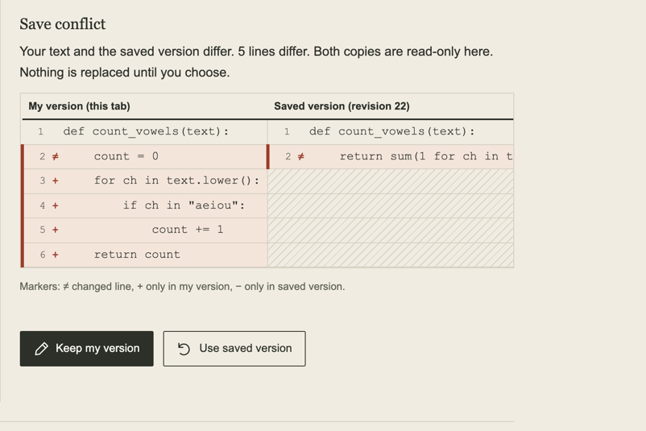

_Figure UG-07a — Save conflict comparison between two different synthetic answers._

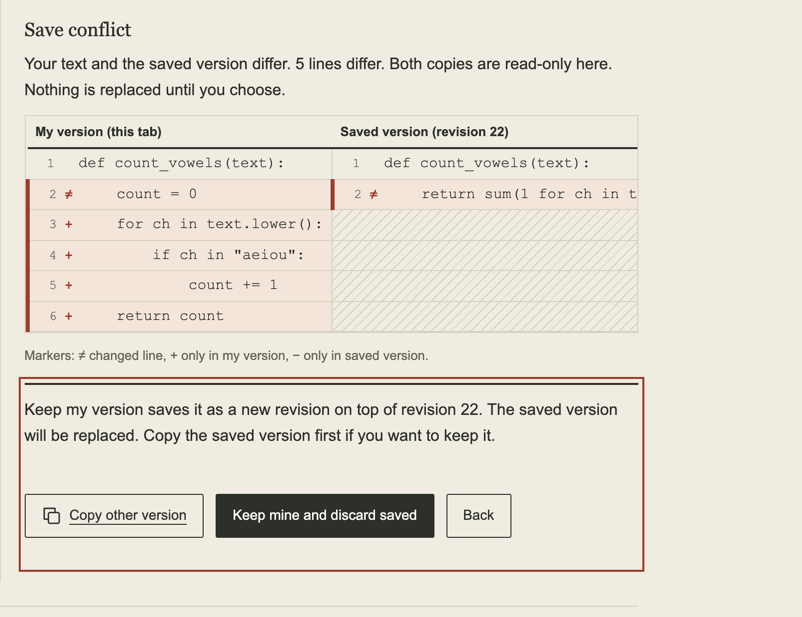

_Figure UG-07b — Confirming a conflict choice. Nothing is replaced until you confirm._

## Student: submit and inspect an attempt

1. Choose **Review assignment**. Each question shows the revision the server acknowledged, or a warning for blank, unsaved or conflicting answers. Use **Edit question N** to fix one. Blank answers are flagged; the system does not fill them in. Nothing is submitted at this step.
2. Choose **Submit assignment…**. **Confirm submission** lists the exact revision and hash that will be snapshotted for each question. Choose **Confirm and submit**, or **Cancel**.
3. Wait for **Assignment submitted**, which shows the server time and attempt ID. The server enforces deadline and publication rules; a rejected request is not a completed attempt. You can submit again before the deadline, and earlier attempts are kept.
4. Choose **View submitted attempt**, or open the **Submitted attempt** tab at any time. Pick an attempt from the **Attempt** selector (newest first). The view shows that attempt's answer for the current question, read only, with the server submission time, attempt ID and pinned version. Later working-copy edits do not change it. In the historical tabs, the last question's forward button becomes **Attempt summary**, which shows all questions of that attempt on one read-only page.

The selected tab and attempt are kept in the page address, so reloads, Back/Forward and shared links reopen the same view. The server rechecks access each time. If an attempt is not yours or no longer available, the view says it is unavailable.

On a connection failure, use **Try again** on the submission error. It retries the same request identity so that you do not accidentally create a duplicate attempt. If you are prompted to reload saved answers or move to a newer publication, do that before confirming a new snapshot. You can keep editing after the deadline, but that does not mean you can still submit.

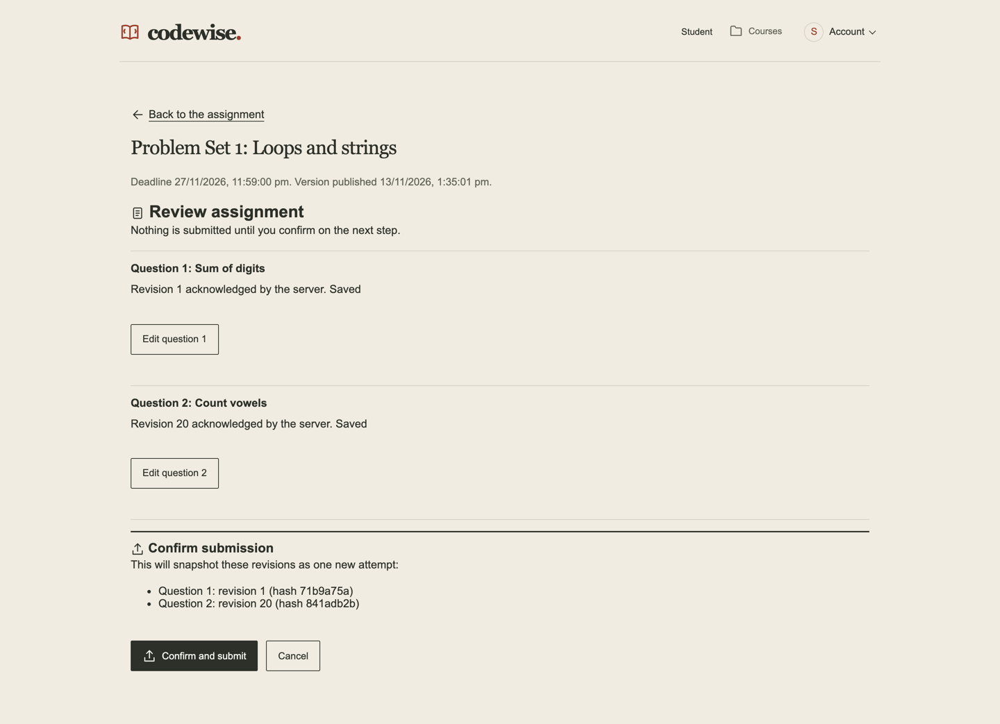

_Figure UG-08 — Review and confirmation before submitting._

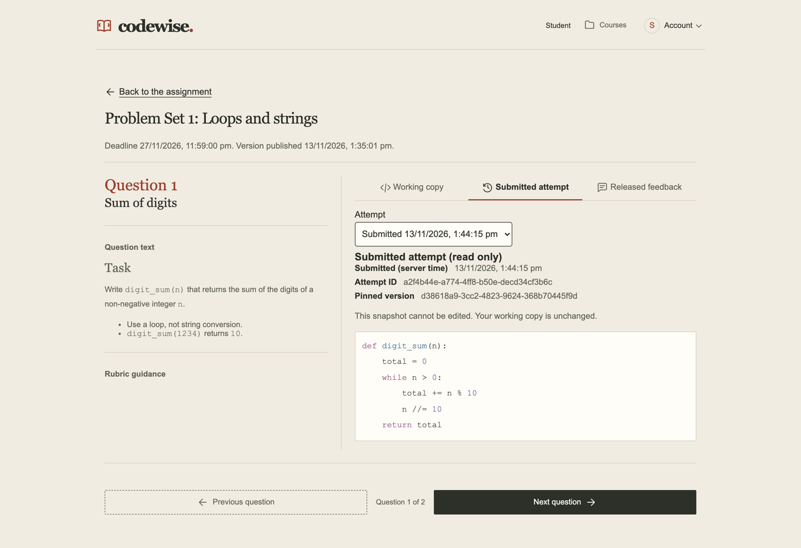

_Figure UG-09 — A submitted attempt: read-only source, attempt ID, pinned version and server submission time._

## Instructor: assess and release

1. Open the course's **Grading** section and choose **View submissions** for an assignment.
2. Under **Published version**, choose the version, then **Review submission** for a student's attempt. Check **Submission details** for the attempt and publication context. Grading always uses the immutable submitted source, never later working-copy edits.
3. Read the **Submitted source**. To leave a line comment, select lines of code, choose **Comment on selection**, check the linked rubric item, write the **Comment** and choose **Add comment**.
4. Under **Feedback & scores**, enter a **Score** and **Feedback for the student** for every rubric item. Use **Previous** / **Next** to grade every question. **Review feedback** shows the total and whether every item is complete.
5. Choose **Save draft**, then **Approve feedback**, then **Release feedback**. These are separate steps. Incomplete or invalid grading cannot be approved, and students see nothing until release. Editing after approval cancels the approval, and you must approve again before releasing. After release, **View released feedback** previews what the student sees.

Where AI is configured and enabled, **AI-assisted grading** offers **Generate AI draft**, which requests a private suggestion. **Generation options** contains **Use instructor reference solutions**. It starts off; turning it on sends the private reference to the AI, so check that suggested feedback does not reveal it. Use **Suggestions for** to review each question's suggested scores and explanations, and **Review notes** for flags. **Apply AI draft to feedback** fills the feedback for all questions at once. It is separate from approval and release, and you still review and save afterwards. **Hide suggestions** and **Generate again** are also available. A blank or whitespace-only answer is graded manually rather than generated.

**AI limitation:** passing validation does not make AI grading correct. The recorded live evaluation found incorrect scores that were accepted and explanations that contradicted themselves. Check every score and statement yourself. AI can be disabled or unavailable; manual grading always remains available. Codewise never releases feedback automatically.

Use **History & corrections** to inspect saved revisions and releases. A correction needs a revised assessment, a new approval and a new release; the student then sees the new version and the old one as replaced. Withdrawal makes the selected released feedback unavailable to the student without changing the submitted attempt.

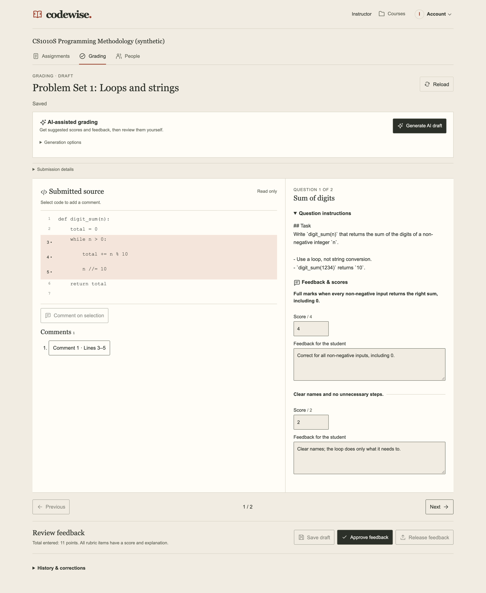

_Figure UG-10 — Manual grading: immutable source, a line comment, criterion scores and the separate save, approve and release controls._

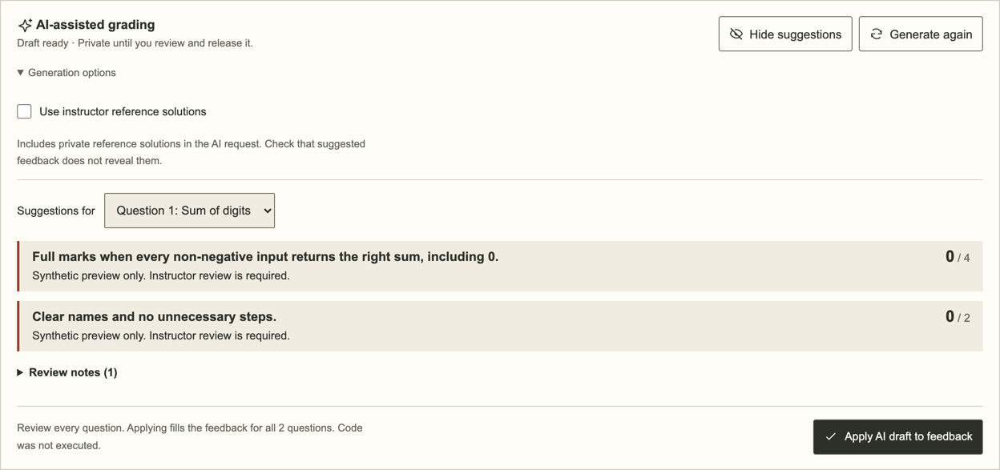

_Figure UG-11 — A private AI suggestion awaiting instructor review. This one comes from the synthetic preview adapter, so its scores are placeholders. It shows why every suggestion needs checking before you apply it._

## Student: read released feedback

Open the **Released feedback** tab, or **View released feedback** on the assignment overview. Pick the attempt from the **Attempt** selector; attempts with released feedback are marked **Feedback released**. For the current question, the view shows criterion scores and explanations, the submitted source, and the instructor's observations. Selecting an observation highlights the matching submitted lines. Observations that no longer match the source are listed separately rather than attached to unrelated lines.

**Feedback version** distinguishes current, replaced and withdrawn feedback. A withdrawn version shows only its withdrawal state, without the former feedback. The submitted source is still available when feedback is pending, unavailable or withdrawn. Feedback for one attempt never replaces another attempt's feedback.

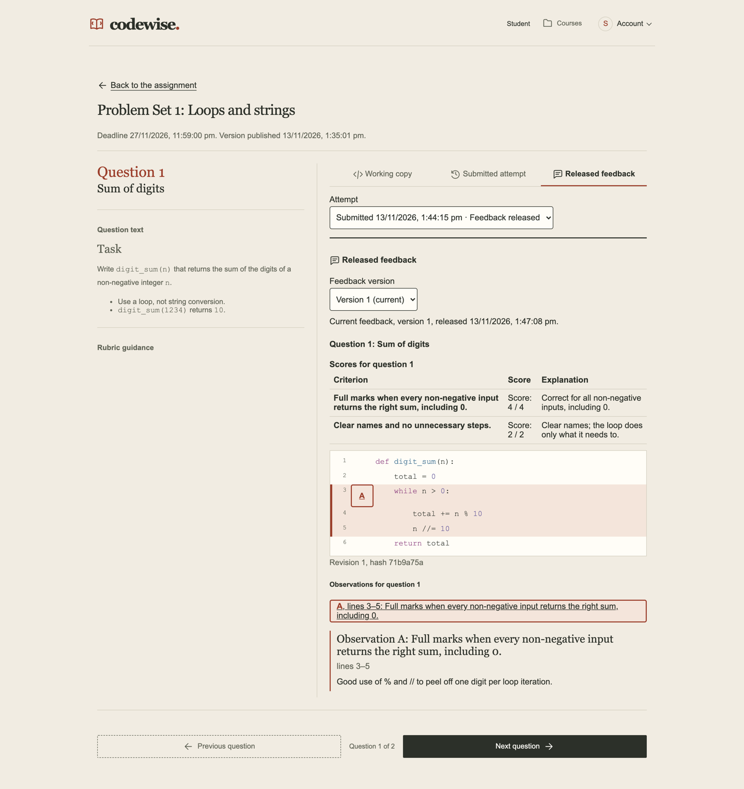

_Figure UG-12 — Released feedback against the exact attempt, with a selected source observation._

## Student: understand your progress

Choose **View my progress** on a course's assignment list. The **Progress** page lists **Released feedback used**: the server picks it automatically from your own released feedback in that course, using the newest released attempt for each assignment, up to 8 assignments. Unreleased, withdrawn or replaced feedback and other students' work are never used, and you cannot add evidence yourself. If nothing has been released yet, the page says **No released feedback in this course yet.** and no AI request is made.

Choose **Explain my progress** to request a private explanation. It summarises your **Recent assignments** (up to 3) and **What went well**. When at least two assignments share a rubric criterion name, it can also list **Recurring issues** and **Supported improvements**. Otherwise it says it is a summary rather than a comparison over time. It also gives **Practice suggestions** and **Limitations**. When every selected criterion is at full marks (worked out from the scores, not by the AI), the page shows **Good job! Keep up the good work.**

The explanation is AI-generated, is labelled as such, and never changes a grade. The server rejects explanations that cite feedback outside the selection or claim improvements the scores do not support, and those explanations are never shown. Only the latest explanation is kept. If your released feedback changes afterwards, the old text is withheld; choose **Generate a new explanation**. When AI is not configured for students, the page shows **Progress explanations are not available right now.**

## Troubleshooting

| What you see                          | Action                                                                         |
| ------------------------------------- | ------------------------------------------------------------------------------ |
| Sign-in unavailable / not configured  | Ask the team to check configuration; there is no bypass                        |
| Expired session                       | Preserve visible unsaved text, sign in, and reopen an authorized workspace     |
| No courses / missing assignment       | Ask the instructor to check accepted membership and publication                |
| Saving failed / too many requests     | Keep the page open, preserve text, wait as directed and retry                  |
| Save conflict                         | Compare both versions, copy what you need, then confirm one choice             |
| Deadline passed / publication changed | Follow the displayed action; a working copy is not an attempt                  |
| No released feedback                  | Wait for release; private assessments and suggestions are not student feedback |
| Attempt or feedback unavailable       | Pick one of your own attempts from the selector; shared links are rechecked    |
| AI unavailable / rejected / stale     | Continue manual grading rather than repeatedly generating to bypass limits     |
| Progress explanation not shown        | Generate a new one if feedback changed; otherwise wait and try again later     |

## Peer-test walkthrough

Sign in with the [reviewer test account](#access-and-testing), create a course and invite a Student account you control. Use the two accounts (Instructor and Student) in the same course. Publish two questions with a future deadline. The student edits both, waits for saved states, confirms submission and records the attempt ID. The instructor opens **Grading**, reviews that exact attempt, grades manually, saves, approves and releases. The student opens the **Released feedback** tab for the same attempt and checks the feedback. Edit the working copy afterwards and confirm the **Submitted attempt** tab still shows the original source. Test conflicts, a newer publication, corrections and withdrawal separately. AI grading and progress explanations need separately verified provider configuration and budget; the manual walkthrough does not need them.
